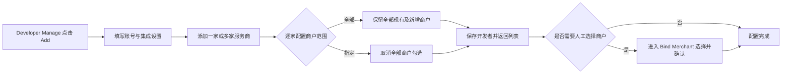
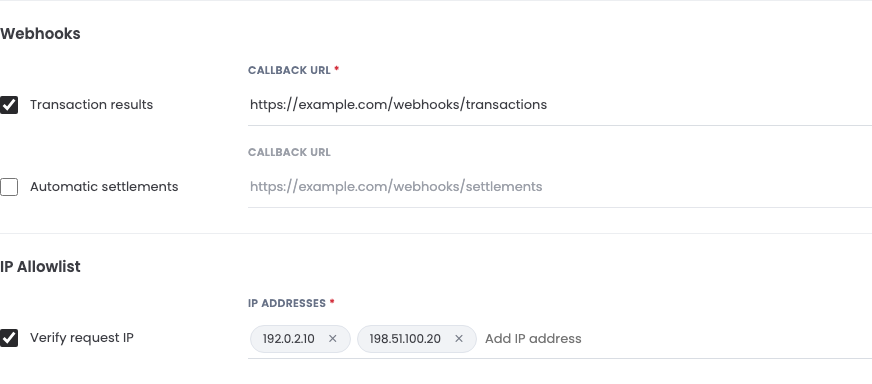
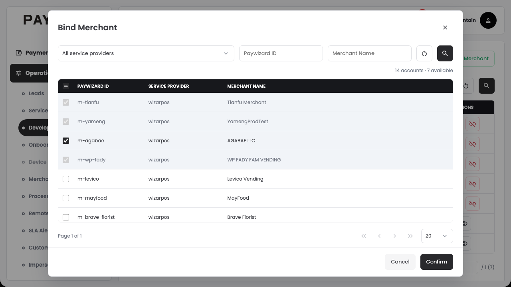

# 开发者账号管理产品需求文档

版本：V1.0  
基准日期：2026-10-21  
状态：研发评审基线  
适用范围：Maintain → Operations → Developer Manage

本期将开发者账号由单服务商关联升级为多服务商关联，并按服务商分别配置商户授权范围。新增、编辑开发者改为独立页面，保留原有商户绑定、平台服务绑定、凭证和白名单管理流程。

本文依据当天已确认的页面与交互整理。文中的“应／必须”为交付要求；当前静态原型仅用于评审和演示，生产实现边界见第 13 节。

## 1. 背景与目标

现有开发者账号每次只能关联一个服务商，无法直接支持同一个开发者为多家服务商提供集成服务。原创建弹窗将基本资料、回调、IP 验证、Token 邮件和服务商混在一起，也未清楚表达关联服务商与取得商户权限之间的区别。

本期目标：

1. 同一开发者账号可关联多个服务商，不因服务商增加而重复创建账号。
2. 每家服务商独立选择“全部现有及未来新增商户”或“指定商户”，两种范围可以在同一开发者账号中并存。
3. 保留已有账号、凭证和绑定关系，避免升级或调整配置时意外扩大权限、撤销无关授权或重置共享 Token。
4. 明确商户权限、Webhook、IP 验证及 Token 邮件各自的作用和生效条件。

例如，开发者 Alpha 同时服务 A、B 两家服务商：A 采用全部商户模式，B 采用指定商户模式且只绑定 B1、B2。Alpha 可访问 A 范围内全部商户以及 B1、B2；A 新增商户时自动纳入，B 新增商户时不自动纳入。

## 2. 本期范围与操作人

### 2.1 页面范围

| 页面 | 本期要求 |
| --- | --- |
| Developer Manage | 保留账号列表、新增、编辑及更多菜单入口 |
| Add Developer / Edit Developer | 由弹窗改为独立页面；基本资料、Webhook、IP、邮件偏好和服务商范围集中配置 |
| Add Service Providers | 搜索、分页、多选服务商，确认后加入账号表单 |
| Bind Merchant | 展示多家服务商下的已授权商户；支持指定模式的人工绑定、解绑 |
| Bind Merchant 选择弹窗 | 按已关联服务商筛选，批量选择可新增商户，明确已有授权的勾选禁用状态 |
| Bind Plat | 管理已关联服务商及其代理商的平台服务绑定 |
| Merchant Token / Platform Token | 保留查看、显隐、重置及发送 Token 的既有操作 |
| Allowlist | 保留逐条新增、删除 IP，与账号表单共用同一份白名单 |

本期不增加“指定现有商户并自动绑定未来新增商户”的第三种模式，不增加独立的新增商户开关，不增加开发者自助开户、审批流程、账号删除或停用入口、Webhook 日志及重试管理页面。

### 2.2 操作职责

本功能由具有现有开发者管理权限的 Maintain 运维人员操作；凭证重置等动作继续受现有操作权限约束。本期不新增角色体系，不把开发者账号等同于 Portal 登录用户。

生产系统必须校验操作人管理权限、开发者与服务商关系，以及具体商户／平台对象是否位于授权范围内。页面隐藏、禁用按钮或传入对象 ID 均不能代替服务端授权校验。

## 3. 业务概念与授权规则

### 3.1 核心概念

| 名称 | 业务含义 |
| --- | --- |
| Developer Account／开发者账号 | 平台集成身份，由 Client ID 标识，可关联多家服务商 |
| Client Secret | 与 Client ID 配套的开发者凭证；不同于商户 Token 或平台 Token |
| 服务商关联 | 确定开发者可以配置哪些服务商下的商户范围和平台服务 |
| 商户授权范围 | 按开发者与服务商分别配置的商户访问范围 |
| 商户绑定 | 开发者与某商户之间的授权关系；同一商户允许关联多个开发者 |
| 平台服务绑定 | 开发者与服务商或代理商之间的服务关系，由 Bind Plat 管理 |
| Merchant Token | 商户的 Terminal 或 ECOMM 集成凭证；同一商户、同一类型跨开发者共享 |
| Platform Token | 服务商或代理商的集成凭证，跨关联该对象的开发者共享 |

### 3.2 授权基本原则

1. 一个开发者必须至少关联一家服务商，可以关联多家；同一家服务商不能重复添加。
2. 每家服务商分别配置范围，互不覆盖。开发者最终商户权限为各家服务商授权商户的合集。
3. 服务商范围包含直属商户及其下级代理商所属商户，不仅限于直属商户。
4. 新增选择及全部模式覆盖范围以符合现有启用条件的商户为准。
5. 商户、服务商和代理商均可关联多个开发者，不属于独占分配。
6. 关联服务商不必然等于获得其全部商户权限；商户范围由该服务商对应的模式决定。
7. 商户访问权限、平台服务绑定、回调偏好和邮件偏好分别管理；关闭邮件或回调不会取消商户权限。
8. 添加或调整服务商范围继续使用同一个 Client ID，不因此生成新的开发者账号或重置 Client Secret。

### 3.3 两种商户范围

| 规则 | 全部商户 | 指定商户 |
| --- | --- | --- |
| 表单配置 | 勾选 All Merchants (Existing & New) | 取消勾选该项 |
| 现有商户 | 纳入该服务商范围内全部符合条件的商户 | 仅人工选择或从全部模式保留的固定清单 |
| 未来新增商户 | 自动纳入 | 不自动纳入 |
| 新关联服务商的默认模式 | 默认采用 | 运维可改为此模式 |
| 是否允许暂时零商户 | 没有符合条件的商户时可以为零 | 可以，先保存服务商，再人工绑定 |
| 单个商户解绑 | 不允许 | 允许，需确认 |
| 排除个别商户 | 不提供排除名单 | 通过保留需要的商户实现 |

## 4. 主流程

### 4.1 新建开发者

1. 从 Developer Manage 点击 Add，进入 Add Developer 独立页面。
2. 填写开发者名称、Email 及其他基本资料。
3. 按需启用交易结果回调、自动结算回调，填写对应地址；配置 IP 验证与 Token 邮件偏好。
4. 在页面底部 Service Providers 点击 Add，从列表勾选一家或多家服务商，点击 Add Selected。
5. 每家新添加服务商默认勾选全部商户。只需要部分商户时，取消该服务商的 All Merchants (Existing & New)。
6. 点击 Create Developer。校验通过并保存成功后，生成 Client ID、Client Secret，沿用现有凭证邮件流程，并返回账号列表。
7. 对指定商户模式，从该开发者更多菜单进入 Bind Merchant，单独选择需要的商户。

指定商户模式不要求在新建页完成商户选择，也不因暂时零商户阻止创建。

### 4.2 编辑开发者

从账号列表的编辑操作进入 Edit Developer。名称和 Email 只读，其余原有可编辑资料、集成设置和服务商范围可调整。

编辑中添加服务商、改变模式或移除服务商均先作为未保存修改；点击 Save Changes 成功后统一生效。返回或取消时，有未保存修改须确认是否放弃。保存成功返回列表，保留列表原筛选、分页及滚动上下文。

服务商配置已被其他窗口修改时，旧页面不得直接覆盖新的授权范围，应提示重新加载，并保留当前输入供操作人处理。

## 5. 新增与编辑页面需求

### 5.1 Basic Information

| 字段 | 必填 | 新建规则 | 编辑规则 |
| --- | --- | --- | --- |
| Developer Name | 是 | 去除首尾空格；名称不可与已有开发者重复，查重不区分大小写 | 只读 |
| Email | 是 | 合法邮件格式，最多 180 字符；不可与已有开发者重复，查重不区分大小写 | 只读 |
| Company Name | 否 | 沿用原有资料字段 | 可修改 |
| Phone Number | 否 | 沿用原有资料字段 | 可修改 |
| Address | 否 | 沿用原有资料字段 | 可修改 |

Email 为开发者凭证邮件和 Token 邮件的接收地址。不新增每家服务商或每种 Token 的独立收件地址。

### 5.2 Webhooks、IP Allowlist 与邮件偏好

页面按 Basic Information、Webhooks、IP Allowlist、New Merchant Token Emails、Service Providers 顺序排列。

两个回调与 IP 验证采用已选定的第一版控件：左侧复选框紧邻业务名称，右侧对齐下划线输入。取消勾选后，输入仍显示、值保留且不可编辑，隐藏必填标记，不使下方内容跳动。详细业务规则见第 9、10 节。

| 配置 | 新建默认值 | 启用后的要求 |
| --- | --- | --- |
| Transaction results | 未勾选 | Callback URL 必填 |
| Automatic settlements | 未勾选 | Callback URL 必填 |
| Verify request IP | 勾选 | 至少一个有效且不重复的 IPv4 地址 |
| Terminal token 邮件 | 未勾选 | 满足新商户自动授权条件时，发送对应 Token 邮件 |
| ECOMM token 邮件 | 未勾选 | 满足新商户自动授权条件时，发送对应 Token 邮件 |

### 5.3 Service Providers 表格

至少一家服务商必填。表格位于页面底部，右上角提供明确的 Add 按钮。

| 列／操作 | 规则 |
| --- | --- |
| Service Provider | 展示所选服务商真实名称 |
| All Merchants (Existing & New) | 每家服务商独立复选框，勾选为全部模式，取消为指定模式 |
| Authorized Merchants | 展示当前授权商户数量及范围类型；不能用服务商总商户数替代指定模式的授权数量 |
| Actions | 使用红色垃圾桶图标移除该服务商；保存时按第 6 节确认影响 |

未选择服务商时展示空状态；移除最后一家后不能保存。页面中的操作只有保存成功后才改变实际授权。

### 5.4 Add Service Providers 弹窗

| 区域 | 要求 |
| --- | --- |
| 搜索 | Provider ID、SP Name，可组合查询；提供搜索、重置 |
| 列表 | 勾选框、Provider ID、SP Name、Merchants |
| 候选来源 | 与现有 Service Provider 列表使用一致的服务商标识、名称和数量来源 |
| 多选 | 支持分页、多选，搜索及翻页后保留本次选择 |
| 禁选 | 已加入本账号表单的服务商和不符合启用条件的服务商不可新增；全选跳过禁选项 |
| 确认 | Add Selected 只将本次新选加入表单，不直接保存开发者 |
| 取消 | 不将本次选择加入表单；有未确认选择时遵循放弃修改确认 |

不展示 Selected、Clear selection 和已选标签工具区，取消本次选择使用对应行复选框。服务商较多时使用搜索和分页，不将演示数据量设为产品上限；至少覆盖 50 条目录的可用性验证。

## 6. 范围变化与服务商移除

所有范围变化以保存成功为生效边界。保存前的勾选变化不影响开发者当前权限。

| 操作 | 保存后的商户权限 | 后续新增商户 | 邮件影响 |
| --- | --- | --- | --- |
| 新增服务商，保持全部模式 | 纳入该服务商全部符合条件的现有商户 | 自动纳入 | 不补发已有商户 Token 邮件 |
| 新增服务商，改为指定模式 | 不自动纳入现有商户；通过 Bind Merchant 选择 | 不自动纳入 | 不因关联服务商发送已有商户 Token |
| 全部 → 指定 | 保留变更生效时已授权商户清单，不因取消勾选立即清空 | 停止自动纳入 | 不补发邮件 |
| 指定 → 全部 | 补齐全部符合条件的现有商户 | 自动纳入 | 不补发已有商户 Token 邮件 |
| 移除服务商 | 撤销本开发者在该服务商范围内全部商户及相关平台服务绑定 | 不再纳入 | 停止该范围后续自动 Token 邮件与回调 |

全部切换为指定后，如只需要其中几个商户，应继续到 Bind Merchant 解绑不需要的商户。系统不另设“选取部分同时自动新增”的组合。

移除服务商时，点击垃圾桶先从表单中移除。保存前须确认服务商名称、受影响商户数量以及商户权限和平台服务将被撤销的后果。取消确认不提交修改；保存失败不产生部分撤权。

移除后必须保留其他服务商范围、其他开发者的关联、对象共享 Token 和历史邮件记录。商户本身不被删除；共享 Token 不因解除本开发者关系而重置。

## 7. Bind Merchant

### 7.1 页面与已授权列表

从 Developer Manage 中该账号的更多菜单进入 Bind Merchant。标题后的开发者名称与标题文字底部视觉对齐；绑定页不提供编辑开发者齿轮入口，修改范围从账号列表的编辑操作进入。

主操作为绿色描边、文件加号图标的 **Bind Merchant** 按钮。所有关联服务商均为全部模式时，该按钮禁用，并说明全部范围已自动包含商户；仍可浏览已授权列表及 Token。

| 区域 | 要求 |
| --- | --- |
| 筛选 | Service Provider、Paywizard ID、Merchant Name，提供搜索与重置；服务商下拉支持搜索与直接选择 |
| 服务商选项 | All service providers，以及该开发者已关联的服务商 |
| 列表列 | Paywizard ID、Service Provider、Merchant Name、Access、Create Time、Actions |
| Service Provider | 按该商户真实归属显示，不使用开发者的单个服务商名称统一填充 |
| Access | 显示 All merchants 或 Selected merchants |
| Create Time | 当前绑定关系建立时间 |
| Token 入口 | 已授权商户可进入其 Merchant Token 页面 |
| Unbind | 仅指定模式行提供；全部模式不提供逐个解绑 |

Paywizard ID 精确查询，Merchant Name 按名称包含查询；筛选和分页只改变展示，不改变授权。

### 7.2 选择商户弹窗

弹窗保留服务商筛选、Paywizard ID、Merchant Name 搜索、重置和分页。列表仅保留勾选框、Paywizard ID、Service Provider、Merchant Name；不展示 MID、BINDING、其他开发者名称或绑定数量。

不展示 Selected 数量、Clear selection 和已选标签区。本次新选通过行复选框取消，搜索、服务商筛选和翻页均保留尚未提交的选择。

| 商户状态 | 展示 | 是否可更改 |
| --- | --- | --- |
| 已由本开发者绑定 | 勾选且禁用，保留已绑定说明 | 不可在本弹窗取消 |
| 已通过全部模式获得授权 | 勾选且禁用，说明属于全部商户范围 | 不可在本弹窗取消 |
| 未绑定本开发者且属于指定模式服务商 | 可新增选择的复选框 | 可以勾选及取消 |
| 仅被其他开发者绑定 | 对本开发者仍可新增选择 | 不构成独占冲突 |
| 未关联服务商下或不符合启用条件的商户 | 不进入可新增候选范围 | 不允许新增 |

全选及取消全选只影响当前筛选结果中可新增的商户，不能改变已有授权的锁定勾选。提交集合只包含本次新增项，不重复提交已绑定项。

点击 Confirm 前至少选择一个可新增商户。提交时重新校验服务商关联、模式、对象有效性及是否已绑定；越界、重复或范围已变化时保留选择并提示刷新处理，不得以旧页面数据绕过限制。确认成功后关闭弹窗并更新主列表。

### 7.3 人工解绑

指定模式商户点击 Unbind 后须确认。成功后只解除当前开发者与该商户的关系，其他开发者关系和共享 Token 保留；该商户不再属于当前开发者的后续访问及回调范围。

全部模式不允许单个解绑。若要缩小范围，先在 Edit Developer 将对应服务商改为指定模式并保存，再在 Bind Merchant 解绑。

## 8. Bind Plat 与平台服务

选择服务商后仍保留原有服务商／代理商平台服务能力。首次关联服务商时，建立该服务商及其现有符合启用条件代理商的平台服务绑定；商户采用指定模式不取消这些平台服务。

Bind Plat 页面及选择弹窗支持按已关联的多家服务商筛选，展示对象真实所属服务商。候选限于这些服务商及其符合条件的代理商，每次单选确认，可多次累计绑定。平台候选沿用原有 BINDING 信息，本轮移除该列的要求仅适用于商户候选。

普通平台解绑只解除对应服务商或代理商的平台服务关系，不级联撤销商户绑定，也不重置共享 Platform Token。它与 Edit Developer 中移除整家服务商的后果不同，后者按第 6 节撤销整个范围。

本期不新增“未来代理商自动绑定”规则；新增代理商的绑定沿用原有管理流程。

## 9. Webhook 与新商户 Token 邮件

### 9.1 两类 Webhook

| 配置 | 触发业务 | 地址与范围 |
| --- | --- | --- |
| Transaction results | 已授权商户发生交易后的交易结果回调 | 原 Notify URL，开发者级统一地址，覆盖多家服务商下实际授权的商户 |
| Automatic settlements | 已授权商户终端每次自动结算后的结算信息回调 | 原 Settle URL，同为开发者级统一地址 |

Settle URL 表示终端自动结算信息通知，不是商户资金打款。

两个复选框独立配置。开启时对应 Callback URL 必填，接受有效 HTTP／HTTPS 地址，不接受其他协议或包含用户名、密码的 URL。关闭后地址保留但不再生效，不因保留的停用 URL 阻止保存。

多家服务商共用该开发者的地址，不新增每服务商回调地址。配置或扩大商户权限不触发历史交易／结算补发；本期不新增补发能力。实际回调协议与既有投递机制继续沿用，开发者只能接收实际授权范围内的信息。

### 9.2 Terminal 与 ECOMM Token 邮件

两个邮件复选框是开发者级的独立偏好，适用于该账号关联的全部服务商；不会因勾选邮件选项自动取得商户权限。

自动邮件必须同时满足：商户为新建商户、属于开发者关联服务商的全部模式、开发者因此实际自动获得该商户授权、对应 Token 类型的邮件偏好已开启。

| 场景 | 自动纳入授权 | 自动发送新商户 Token 邮件 |
| --- | --- | --- |
| 全部模式服务商新建商户 | 是 | 按 Terminal／ECOMM 各自偏好发送 |
| 指定模式服务商新建商户 | 否 | 不发送 |
| 人工绑定已有商户 | 绑定后有权限 | 不发送 |
| 指定切换为全部，补齐已有商户 | 是 | 不补发 |
| 添加一家已有服务商并选择全部 | 是 | 不补发已有商户 Token |
| 单独开启邮件偏好 | 不改变权限 | 不补发历史商户 Token |
| 只启用 Webhook | 不改变权限 | 不触发 Token 邮件 |

同一个新商户事件重复到达时，不得重复建立授权或重复触发同一开发者、同一商户、同一 Token 类型的自动邮件。多名开发者分别获得授权时，按各自偏好处理，不能因商户已被其他开发者绑定而跳过。

自动流程在新商户创建成功后衔接，授权未成功建立时不得先向该开发者发送 Token。邮件投递结果沿用现有邮件机制，本期不新增邮件任务管理页面；账号或绑定保存成功不等于邮件已送达。

## 10. IP 白名单与凭证管理

### 10.1 IP 白名单

Verify request IP 表示是否核验开发者请求来源 IP。勾选时至少配置一个有效 IPv4 地址；提供的地址不得重复。本期不扩展 IPv6、CIDR 网段或其他地址表达方式。

账号表单通过标签输入维护 IP：支持 Enter、逗号、批量粘贴和移出输入时确认，单项可删除；无效输入保留并就地提示。取消 IP 验证后，已保存地址保留，表单中输入与标签删除禁用；再次勾选时恢复编辑和校验。

独立 Allowlist 页面和账号表单使用同一份地址列表。验证开启时，不允许在独立页面删除最后一个 IP，应提示先在编辑开发者页面关闭验证；关闭后独立页面仍可维护地址并允许删空。地址格式与重复校验继续有效。

### 10.2 凭证和 Token

| 操作 | 要求 |
| --- | --- |
| 创建开发者 | 生成 Client ID / Client Secret，沿用凭证邮件流程 |
| Resend Email | 重发当前 Client ID / Client Secret，不更换密钥 |
| Reset Secret | 确认后更换 Client Secret，并沿用新凭证邮件流程 |
| Merchant Token | Terminal、ECOMM 分别管理，同商户同类型跨开发者共享 |
| Platform Token | 服务商或代理商对象共享，不因关联多个开发者生成独立 Token |
| Reset Token | 明确提示共享影响及相关开发者；重置影响所有使用者，不自动邮件 |
| Send Token | 发送至该开发者已保存 Email，与重置操作分开 |
| 凭证展示 | 默认遮蔽中间内容，保留首尾各四位，支持显隐 |

解绑商户、解绑平台或移除服务商均不删除、重置对象共享 Token。失去对应绑定后，当前开发者不能继续通过该关系查看或操作 Token。

## 11. 交互反馈与异常处理

### 11.1 通用交互

沿用 Portal 的侧栏、顶栏、返回箭头、字体和黑色紧凑表头。表单使用下划线输入；表单操作 40px，行操作 36px，表头 34px／11px，图标风格保持一致。只验收桌面浏览器。

下拉同时支持直接选择、输入搜索和键盘操作；选项独立滚动，弹层不得被弹窗或底部按钮裁切。服务商和商户弹窗不再加入已取消的已选工具区。

成功及一般信息使用右上角 Toast，不占据表格上方空间：默认约 3 秒后消失，支持手动关闭，悬停或键盘聚焦时暂停。字段、保存及提交错误必须持久可见，自动定位并聚焦到实际滚动容器内，不能仅以短暂 Toast 提示。

### 11.2 异常与处理

| 场景 | 系统处理 |
| --- | --- |
| 必填、Email、URL、IP 校验失败 | 保留输入，标记字段原因，定位可见错误；不提交修改 |
| 未选择服务商或尝试重复添加 | 阻止保存／新增，提示选择有效服务商 |
| 指定模式暂时零商户 | 允许保存，后续通过 Bind Merchant 配置 |
| 筛选没有结果 | 显示空状态；不清除其他筛选条件下的新选择或已有绑定 |
| 弹窗没有可新增商户 | 不得把已勾选禁用项当作新选择提交，提示当前无可新增对象 |
| 同一账号范围被其他操作人修改 | 不得静默覆盖新范围；提示重新加载并保留当前输入 |
| 绑定提交时对象已绑定、失效或越界 | 重新校验并提示原因；不能重复授权或跨范围绑定 |
| 保存或绑定失败 | 保留输入与选择，恢复操作入口；不得提示成功或形成部分保存 |
| 重复点击提交 | 提交过程中防止重复操作，不得重复创建账号、绑定或触发邮件 |
| 直接进入不存在账号或已失去关系的 Token 地址 | 提示对象／关系不可用，返回有效列表重新选择 |

账号设置、服务商范围和相应绑定变化应作为一次完整业务提交：成功后共同生效，失败时不得出现表单已保存但授权仅改动一部分的状态。生产实现需针对并发、重复提交和重复新商户事件验证这一要求。

## 12. 旧账号迁移与验收标准

### 12.1 旧账号迁移

旧单服务商账号升级时，原服务商转换为一条关联记录，并采用指定商户模式，保留原有商户清单。不能因为旧账号关联过服务商，就推断其已获得全部现有或未来商户权限。

迁移保留 Client ID、Client Secret、商户及平台绑定、共享 Token、基本资料、IP、邮件偏好与历史邮件记录。原回调地址有值时对应复选框启用，无值时关闭。迁移不自动补发邮件，不新增账号，不扩大授权。

### 12.2 业务验收场景

| 编号 | 场景与操作 | 预期结果 |
| --- | --- | --- |
| AC-01 | 新建开发者同时添加 A、B 服务商 | 只生成一个账号，两家服务商均保存；无重复关联 |
| AC-02 | A 全部、B 指定，B 暂不选商户 | 可成功创建；A 有全部符合条件商户权限，B 为零商户但保留平台服务 |
| AC-03 | 在 Bind Merchant 选择 B1、B2 并确认 | 只新增 B1、B2；A 的授权不变 |
| AC-04 | A、B 分别新增 A3、B3 | A3 自动纳入，B3 不自动纳入 |
| AC-05 | AC-04 中只勾选 Terminal 邮件 | 仅对获自动授权的 A3 触发 Terminal 邮件，不触发 ECOMM，不向 B3 发送 |
| AC-06 | 同一 A3 新建事件重复处理 | 不重复绑定、不重复触发对应自动邮件 |
| AC-07 | A 从全部切换为指定并保存 | 当前授权商户清单保留，未来新增不再自动纳入；可人工解绑 |
| AC-08 | B 从指定切换为全部并保存 | 补齐 B 范围内符合条件的现有商户，后续自动纳入，不补发已有 Token 邮件 |
| AC-09 | 移除 A，在影响确认中取消 | 不提交撤权；A 当前有效授权、Token 和其他范围不变 |
| AC-10 | 确认保存移除 A | 只撤销当前开发者在 A 下商户及平台服务绑定；B、其他开发者和共享 Token 不变 |
| AC-11 | 打开商户选择弹窗 | 本开发者已绑定及全部模式商户均勾选禁用；无 MID、BINDING、Selected 或标签工具区 |
| AC-12 | 弹窗全选后取消全选 | 只取消可新增对象，锁定勾选不变；已有绑定不进入本次提交集合 |
| AC-13 | 选商户后搜索、换服务商、翻页再返回 | 本次新选择保留；提交成功只新增选中项 |
| AC-14 | 商户已关联其他开发者 | 仍允许当前开发者绑定；不影响其他开发者关系 |
| AC-15 | 全部模式尝试单个解绑；全部服务商均为全部模式 | 不允许逐个解绑；Bind Merchant 禁用并说明原因 |
| AC-16 | 指定模式解绑一个商户 | 确认后只解除当前关系，其他开发者及共享 Token 保留 |
| AC-17 | 在 Bind Plat 普通解绑一个平台对象 | 对应平台关系解除，商户授权不被级联取消 |
| AC-18 | 关闭一个回调或 IP 验证后再开启 | 内容保留，禁用与必填标记正确联动；另一项配置不受影响 |
| AC-19 | 开启 IP 验证但为空、重复或格式无效；独立页删除最后一个 IP | 阻止不合法保存／删除并给出可见原因；两个入口保持同步 |
| AC-20 | 手工绑定已有商户、开启邮件偏好或切换全部模式 | 不因此补发已有商户 Token 邮件；原 Send 操作仍可使用 |
| AC-21 | 旧单服务商账号迁移 | 原清单、凭证、配置保留，采用指定模式，不扩权、不补邮件 |
| AC-22 | 保存失败、范围并发变化或重复提交 | 输入不丢失，无静默覆盖、部分保存、重复账号或重复绑定 |
| AC-23 | 服务商目录达到 50 条，跨页查询和多选 | 搜索分页可用、选择不丢、禁选项不被全选加入；数量不是产品上限 |
| AC-24 | 查看三个设置组及操作反馈 | 与选定第一版一致；成功提示右上角自动消失，错误持续可见并定位 |

## 13. 研发交付边界

当前原型已展示独立账号页面、多服务商范围、商户及平台绑定、控件状态和本地演示结果。商户新增观察、自动授权和邮件记录在浏览器本地模拟，不能作为生产鉴权、真实新商户事件、邮件或 Webhook 投递已经完成的证明。

生产交付至少应完成：多服务商关系保存、各家范围独立生效、既有接口的对象范围校验、全量与指定两类访问控制、商户新建后的自动纳入及邮件条件、移除后的访问与回调限制，以及旧数据迁移。实际邮件、回调地址与原有服务集成，不能只完成前端表单和列表。

服务商候选应使用现有服务商目录及其稳定标识。当前原型同步的页面目录和商户数量仅用于评审，不等于已导入这些服务商的商户明细；生产授权数量及候选必须来自实际商户关系，不能使用演示总数代替。

服务商／商户后续停用、商户跨服务商迁移等生命周期继续沿用既有系统规则。本期未重新定义这些流程，不依据原型中的演示数据自行增加级联撤权或跨服务商自动迁移规则；如既有流程与新的范围模型存在冲突，应单独评审后补充。

## 14. 页面与设计依据

| 类型 | 链接 |
| --- | --- |
| 开发者列表 | [Developer Manage](../../50.developer_manage.html) |
| 新增／编辑表单 | [Developer Form](../../50.developer_form.html) |
| 绑定商户／平台 | [Developer Binding](../../50.developer_binding.html) |
| 白名单 | [Allowlist](../../50.developer_allowlist.html) |
| Token | [Developer Token](../../50.developer_token.html) |
| 已确认设计及流程细节 | [开发者账号管理设计](../design/developer-management-replica.md) |
| 领域决策 | [按服务商定义开发者商户权限](../adr/0016-developer-merchant-access-per-provider.md) |
| 页面和交互验收记录 | [开发者账号管理验收](../validation/developer-management/README.md) |

账号相关页面需从列表选择具体账号进入，以上链接用于定位原型页面。截图供布局评审，授权规则以本文为准。

### 已确认的三个设置组

### 已确认的商户选择状态

