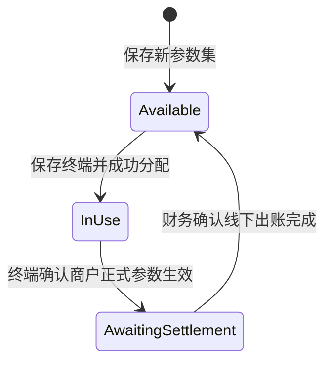
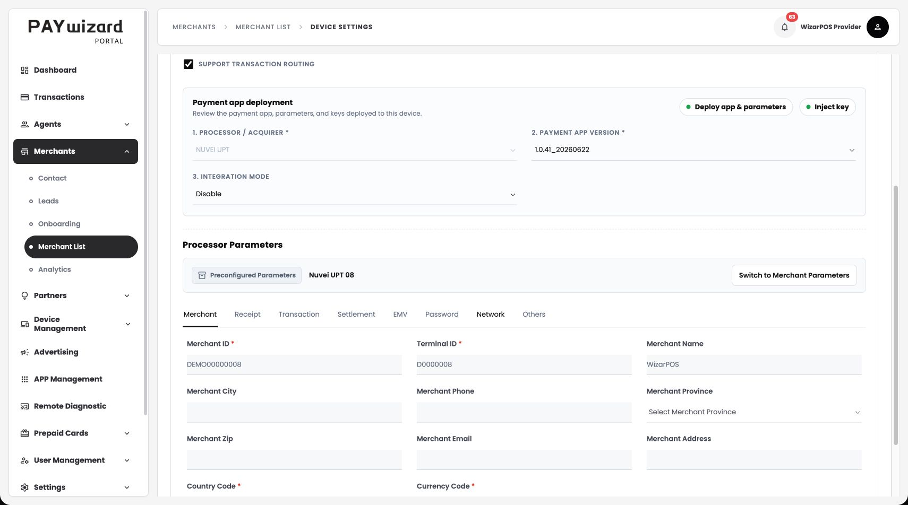
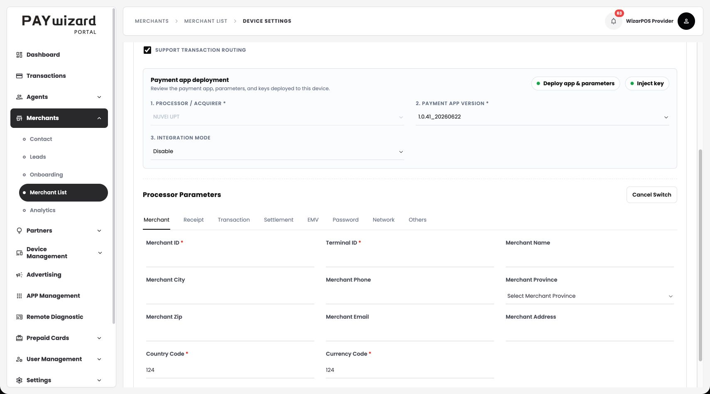

# Parameter Pool 与商户正式参数切换｜产品需求文档

版本：V1.0  
基准日期：2026-10-16  
设计基线：当前已确认的 Paywizard Portal 原型  
适用范围：WizarPOS Provider 管理的 NUVEI UPT 临时参数使用、正式参数切换、人工出账确认及参数循环复用。

本文将已确认方案整理为一份当前需求基线，不沿用早期讨论中已取消的页面、字段和步骤。文中的“应／必须”为产品交付要求；原型演示与真实系统的差异见第 12 节。

## 1. 背景与目标

部分商户的 Nuvei 正式收单参数准备时间较长。根据业务方提供的渠道合作前提，WizarPOS 可先提供自己已验证的支付参数供商户临时使用，待商户正式参数取得后，在原有终端配置上完成切换。临时使用期间的款项由财务在线下核对并向商户出账。

Paywizard 本期承担四件事：管理可循环使用的参数集；为单台终端分配一套参数；支持原终端切换为商户正式参数；提供每次使用的交易统计、明细及导出，并在财务确认出账后释放参数集。

目标是复用现有商户、门店、设备和参数下发流程，减少进件等待对商户启用的影响。商户不需要重新开户、重建门店、重新认领设备或迁移历史交易。

“10 套参数”“使用约 3 周”为业务示例，不是数量上限或自动到期规则。系统不承诺通过本功能保证渠道进件时效，也不设置到期自动切换。

## 2. 本期范围

| 模块 | 本期内容 |
| --- | --- |
| Maintain → Parameter Pool | 列表、搜索、状态筛选、新建、可用参数编辑、使用记录入口 |
| Add / Edit Parameter Set | 参数集名称、现有支付渠道、完整 NUVEI UPT 参数表单 |
| Usage Records | 每次使用的归属、起止时间、状态、交易统计、完整明细、导出、确认出账 |
| Add Device → Processor Parameters | Manual Entry / Parameter Pool；单选参数集；参数只读回填 |
| Settings → Edit Params | 预配置参数标识、切换前确认、商户参数编辑、原有下发确认、等待生效 |
| 交易规则 | 每次使用独立归属；切换生效后旧交易禁止商户后续交易操作；历史查询保留 |

本期不新增 Onboarding 流程、批量分配、多选参数集、参数验证流程、参数集版本管理、自动对账、手续费或分润计算、实付金额计算、转账功能、财务审批流、凭证上传、强制释放、自动回滚及定时切换。

商户和门店通过现有 Merchant List 流程创建，支付渠道设置及设备绑定沿用原流程。早期提出的“选择参数集时自动添加门店支付渠道”尚未纳入当前原型，本版不将其列为已交付能力；若后续实施，需要单独补充门店渠道关联规则。

## 3. 术语与操作职责

### 3.1 术语

| 名称 | 定义 |
| --- | --- |
| Payment Channel／支付渠道 | 平台已有的渠道配置。本期参数池支持 NUVEI UPT 对应渠道 |
| Parameter Set／参数集 | 一套命名的渠道支付参数，包含 MID、TID 及该模板的其他字段；无独立版本字段 |
| Parameter Pool／参数池 | 运维维护的、供商户临时使用的参数集集合 |
| Parameter Usage Record／使用记录 | 某参数集分配给某商户、门店和 TCI 的一次使用。每次重新分配均新建记录 |
| TCI | 现有终端配置标识；切换参数前后保持不变，与设备 SN 分开管理 |
| Merchant Parameter Switch／商户参数切换 | 在现有 TCI 上将资源池参数替换为商户自己的正式参数，以终端确认生效为完成边界 |
| Confirm Settlement／确认出账 | 财务确认本次临时使用对应的线下出账已完成，并允许释放参数集；不是平台发起打款 |

NUVEI UPT 参数页内的 **Settlement** 页签是渠道终端参数，与本功能的人工 **Confirm Settlement** 不是同一操作。

### 3.2 职责与权限

| 操作 | 运维 | 财务 | 商户 |
| --- | --- | --- | --- |
| 新建、编辑可用参数集 | 按现有授权 | 不作为财务必需操作 | 不提供 |
| 为终端选择参数集、切换正式参数 | 按现有授权 | 不作为财务必需操作 | 不提供本功能入口 |
| 查看使用记录、统计与导出 | 按现有授权 | 按现有授权 | 不开放参数池全量记录 |
| 确认线下出账完成 | 仅具备相应授权时 | 按现有授权执行 | 不提供 |
| 查询自己的交易 | 按管理范围 | 按管理范围 | 沿用现有权限，包含自己的两个阶段 |

当前原型统一以 WizarPOS Provider 身份展示管理能力；本期不新增角色管理页面。生产系统须通过现有权限体系约束操作人与数据范围，不能仅依赖隐藏按钮。

## 4. 状态流转

### 4.1 参数集状态：只表示当前能否分配

| 状态 | 含义 | 允许操作 | 不允许操作 |
| --- | --- | --- | --- |
| Available／可用 | 未被当前使用记录占用，可供下一台终端使用 | 编辑、分配、查看历史记录 | 无使用记录时确认出账 |
| In Use／使用中 | 已分配给一个商户／门店／TCI，包括等待切换生效期间 | 查看使用记录；从该终端发起正式参数切换 | 编辑参数集、再次分配、提前出账释放 |
| Awaiting Settlement／待结算 | 正式参数已生效，上一轮临时使用结束，等待人工出账 | 查询、导出、确认出账 | 编辑、再次分配 |

参数集没有 Settled 状态。出账确认完成后参数集恢复 Available，但历史使用记录保持 Settled。

### 4.2 使用记录状态：表示某一轮使用的结果

| 事件 | 使用记录状态 | 记录内容与时间 |
| --- | --- | --- |
| 终端配置保存、分配成功 | In Use | 新建唯一 Usage ID；保存商户／门店／TCI 和参数快照；开始时间为分配成功时间 |
| 终端确认正式参数生效 | Awaiting Settlement | 记录结束时间；冻结该次使用交易的商户后续操作 |
| 财务确认出账 | Settled | 记录确认人、确认时间；永久保留原归属、快照、交易关联 |

开始时间不是第一笔交易时间。没有发生交易也有使用记录。已结束且零交易的记录仍通过人工确认出账释放，不自动跳过此步骤。

### 4.3 切换请求与页面状态

| 阶段 | 页面表现 | 参数集／使用记录是否改变 |
| --- | --- | --- |
| 浏览资源池参数 | 显示 Preconfigured Parameters 与参数集名称，参数只读 | 不改变 |
| 确认已取得正式参数 | 打开确认弹窗；确认后进入编辑 | 不改变 |
| 编辑正式参数 | 隐藏整个预配置参数条，显示 Cancel Switch | 不改变，终端仍使用原参数 |
| Confirm & Deploy 提交成功 | 等待终端确认，禁止重复提交和继续改参数 | 保持 In Use |
| 终端确认失败 | 提示失败，原使用继续有效 | 保持 In Use，不冻结、不释放 |
| 终端确认生效 | 展示商户参数，结束旧使用 | 转为 Awaiting Settlement |
| 未收到结果 | 保持等待状态 | 不得按成功处理 |

“进入编辑”“保存输入”“下发请求成功”“终端确认生效”必须区分。只有最后一个事件触发旧使用结束。在线、离线、是否正在交易由人工判断，本期不新增在线状态或交易空闲状态的提交门槛。

## 5. 页面与字段需求

### 5.1 Maintain → Parameter Pool

原型：[Parameter Pool](../../49.parameter_pool.html)。

| 区域 | 字段／操作 | 规则 |
| --- | --- | --- |
| 搜索 | 搜索框、搜索按钮 | 名称、渠道、MID、TID、关联商户、门店、TCI 模糊匹配；点击搜索或 Enter 执行 |
| 状态筛选 | All、Available、In Use、Awaiting Settlement | 与搜索组合生效 |
| 主操作 | Add Parameter Set | 进入新建页 |
| 列表 | Parameter Set Name、Channel、MID、TID、Status | 展示参数集当前信息 |
| 当前关联 | Merchant、Store、TCI | In Use 和 Awaiting Settlement 显示当前使用方；Available 不显示上一任为当前使用方 |
| 行操作 | Edit、Usage Records | Edit 仅 Available 可用；Usage Records 可查该参数集全部历史使用 |

列表为空时显示空状态；筛选无结果时不得当作资源不存在或丢失历史。表头、按钮、状态标识复用 Portal 既有样式。

### 5.2 Add / Edit Parameter Set

原型：[Add / Edit Parameter Set](../../49.parameter_pool_form.html)。页面分为 Basic Information 与 Processor Parameters 两张卡片。

| 字段／区域 | 必填 | 输入及规则 |
| --- | --- | --- |
| Parameter Set Name | 是 | 去除首尾空格，最长 80 字符；例如 Nuvei UPT 08 |
| Payment Channel | 是 | 从平台已存在且符合 NUVEI UPT 的支付渠道中单选，可搜索；不在这里创建新渠道 |
| Processor Parameters | 按原模板 | 复用 NUVEI UPT 8 个页签、57 个字段，见附录 A |
| Save | — | 基础校验通过即保存，无验证中或待审批状态 |
| Cancel／返回 | — | 不保存本次改动 |

保存规则：

1. 新建成功即 Available。不存在单独的“验证参数”按钮或渠道联机检查。
2. 检查必填、长度、数字类型和枚举选项；同一渠道下 MID + TID 组合不得重复。参数集名称不作为支付参数唯一性依据。
3. 只有 Available 可编辑，提交时再次检查状态，避免页面打开后已被他人分配。
4. 无可选渠道时提示先到 Payment Channel 维护现有渠道。
5. 编辑参数集只影响未来分配；已发生使用的参数快照及交易归属不变。
6. 不新增 Parameter Version 或 Template Version。NUVEI UPT 既有模板直接提供表单；Payment App Version 仍是终端页的独立字段。

### 5.3 Add Device → Processor Parameters

原型：[Add Device](../../5.merchant_add_device_iso.html)。入口必须携带已创建的商户和门店上下文。

| 字段／操作 | 规则 |
| --- | --- |
| Parameter Source | 默认 Manual Entry；NUVEI UPT 可选择 Parameter Pool |
| Parameter Set | 选择 Parameter Pool 后出现；可搜索、单选，不支持多选或批量分配 |
| 参数集选项信息 | 显示名称、MID／TID、可用状态；占用项显示商户／门店／TCI，禁止选择 |
| 参数回填 | 选择后回填该参数集全部参数，输入框、下拉及开关均只读 |
| 原有其他字段 | 沿用设备页，Payment App Version 不因选择参数集被覆盖或锁定 |
| 原页面保存 | 保存终端配置成功时才占用参数集并建立使用记录 |

选择下拉项不会占用资源，关闭页面也不会产生使用记录。切回 Manual Entry 时恢复此前手工输入。使用池参数时不允许通过复制配置或保存参数模板将只读参数变成另一份可编辑配置。

提交必须再次检查资源可用性、渠道存在性、所选参数是否已被修改，以及商户／门店／TCI 归属。资源已被他人占用时保留其他输入，提示重新选择；参数已改动时要求重新加载后选择。两人并发提交同一资源，只能有一人成功。

分配成功应同时保存终端配置、使用记录及占用关系，不能出现“终端未保存但资源已占用”的半完成结果。设备继续出现在原商户和门店的设备列表。

原流程允许未绑定 SN 时保存配置；此时成功分配仍占用资源，但不能说明设备已经开始收款。切换正式参数的下发操作需要原流程已完成设备绑定，这与在线／离线判断不同。

### 5.4 Settings → Edit Params → Processor Parameters

原型：[Edit Params](../../5.merchant_device_settings_iso.html)。从该商户门店设备的 Settings 进入，保持正确的 merchantId、storeId 和 TCI；返回时回到原商户详情。

#### A. 正在使用预配置参数

标题下方展示浅灰底、细边框的紧凑信息条：左侧配置图标、**Preconfigured Parameters** 标识及参数集名称；右侧 **Switch to Merchant Parameters**。参数只读。

标识采用页面既有字体与紧凑字号（标识 12px、名称 13px），通过图标、底色和层级识别来源。删除原有大字号 Parameter Source／Parameter Pool 文本，不额外展示说明段落和 View usage record 链接。

#### B. 点击切换：先确认正式参数已取得

弹窗内容：

| 项目 | 当前设计文案 |
| --- | --- |
| 标题 | Switch to Merchant Parameters |
| 问题 | Have you received the merchant’s official payment parameters? |
| 影响说明 | After you submit the new parameters and they take effect, the current parameter set will enter Awaiting Settlement. It can be reused only after settlement is confirmed. |
| 取消 | Cancel |
| 确认 | Yes, Continue Editing |

Cancel、Esc 或点击弹窗外部均关闭弹窗，保留原参数及资源状态。确认仅表示允许进入编辑，不代表切换完成或财务可出账。

#### C. 编辑商户正式参数

确认后加载同一 NUVEI UPT 模板的完整可编辑表单，使用模板默认值；MID、TID 以及原池中商户身份内容不带入，运维填写新商户正式参数。旧参数中的密码、批次和流水等不能作为上一商户配置直接继承；模板默认值仍需运维按正式参数核实。

**整个预配置参数信息条必须隐藏**，包括标识、旧参数集名称、原切换按钮；不显示 Merchant Parameters — Editing 或任何旧参数集名称。Processor Parameters 标题右侧显示 **Cancel Switch**。

Cancel Switch 放弃本次编辑，恢复原参数只读状态及预配置参数信息条，不改变任何业务状态。校验错误必须仍然可见，自动定位到相应页签和提示位置，不能随信息条一起被隐藏。

#### D. 提交与生效

1. 沿用原页面 Redeploy Parameters 和下发确认弹窗；切换必须包含 Payment Parameters 下发范围。
2. 确认信息展示新 MID／TID，并提示：终端确认变更后，旧池参数交易只读并等待结算。
3. 最终按钮为 Confirm & Deploy。取消这层确认保留已填写的商户参数，可继续修改。
4. 提交成功进入等待终端确认，禁用重复提交及参数编辑；保持旧资源和使用记录 In Use。隐藏预配置参数条，仅显示必要等待状态。
5. 终端确认新参数生效后，同步更新当前终端参数来源、结束旧使用、冻结旧交易后续操作、将旧参数集转为 Awaiting Settlement。
6. 已切换状态继续显示商户自己的参数，不再显示预配置参数条；商户、门店、设备绑定、TCI 不变。
7. 下发失败保持旧使用和旧有效配置；不能把失败或结果未知当作切换成功。真实回执、异常恢复和重试与现有下发能力对接，不增加自动在线检测流程。

### 5.5 Parameter Pool → Usage Records

原型：[Usage Records](../../49.parameter_pool_usage.html)。通过列表指定参数集进入，默认选中最近一次使用；可搜索下拉切换到历史记录。

| 区域 | 字段／操作 | 规则 |
| --- | --- | --- |
| Usage Record | 本参数集的各次使用记录 | 按使用开始时间倒序；选项展示商户、日期、状态及门店／TCI |
| 基础信息 | Merchant、Store、TCI、Record Status | 来自所选使用记录，不从当前占用方反推 |
| 时间及参数 | Started At、Ended At、MID、TID、Channel | 时间明确 UTC；进行中结束时间为空；MID／TID 来自本次快照 |
| 出账信息 | Confirmed At、Confirmed By | 仅已确认出账记录显示 |
| Transaction Summary | Currency、Type、Status、Count、Transaction Amount | 统计本次使用全部交易，按币种／类型／结果分组 |
| 明细 | 原有交易字段、列选择、分页 | 当前页每页 10 条，处理时间倒序，完整字段见附录 B |
| 导出 | Export | 导出所选使用的完整统计和全部明细，不受当前页和可见列限制 |
| 确认出账 | Confirm Settlement | 仅当前待结算记录显示并允许操作 |

页面不增加顶部四张统计卡片。金额仅表示对应分组的交易金额合计，不将 Purchase、Refund、Void 等直接累加成“应结算款”，不跨币种相加，不扣除未知手续费，不展示分润或实际打款金额。

结果沿用既有 Transaction Record 定义（Completed／Failed）；处理中的支付请求不作为 Pending 交易记录加入列表。失败记录参与对应失败分组及完整导出，不能混入成功收款金额。金额精度按交易币种处理，原型 CAD 示例不代表所有币种固定两位小数。

没有使用记录时显示空状态；已有使用但无交易时显示 0 transactions 和空明细。已结束记录提示交易只读、商户后续交易操作不可用。

#### 导出规范

CSV 包含三个部分：

1. 导出时间、Usage ID、参数集名称、商户 ID／名称、门店 ID／名称、TCI、使用起止时间、使用状态、出账确认人和时间。
2. 与页面相同口径的完整交易统计。
3. 全部明细，包含 Usage ID、Merchant ID，以及附录 B 的全部 28 列。

导出覆盖所有分页、成功和失败记录，不仅是当前可见列。时间标明时区，卡号保持脱敏，空值保持为空；文件使用可被常用表格软件识别的 UTF-8，并处理 CSV 引号及公式字符，避免破坏数据展示。

### 5.6 确认出账

财务在系统外核对渠道数据、确定实际应付金额并完成向商户出账，然后进入对应待结算记录点击 Confirm Settlement。

确认弹窗展示参数集、商户、门店和 TCI，明确确认“线下出账已完成，参数集将释放供下一商户使用”。取消不改变状态。平台不要求填写手续费、打款金额、分润或上传凭证。

确认成功后，使用记录变为 Settled，记录操作人和时间；参数集变为 Available，清除当前占用关系；历史数据保留。已经切换为商户参数的原终端不受释放动作影响。

打开页面、弹窗和最终提交之间若使用状态或交易数据改变，应阻止使用旧页面直接确认，并提示查看最新数据后再次确认。此规则用于避免确认错记录，不引入系统自动对账。

## 6. 完整操作流程

### 6.1 准备并分配

1. 运维在 Maintain → Payment Channel 确保已有适用渠道。
2. 在 Parameter Pool 录入已验证的 NUVEI UPT 参数集，保存为 Available。
3. 从现有 Merchant List 新建商户和门店，完成现有渠道配置。
4. 在该门店 Add Device，填写原有设备字段及绑定信息，在 Processor Parameters 选择 Parameter Pool。
5. 单选一个 Available 参数集，检查只读回填值及独立的 App Version。
6. 保存终端。成功后新建使用记录，参数集变为 In Use；后续按现有设备部署流程启用收款。

### 6.2 正常交易与切换

1. 商户按原有方式交易和查询，交易关联本轮 Usage ID 与固定商户／门店／TCI。
2. 运维取得商户正式参数后，从原终端 Settings → Edit Params 点击 Switch to Merchant Parameters。
3. 确认已取得正式参数，填写完整商户参数。此时原终端仍按旧有效配置工作。
4. 人工判断合适时机，按原流程 Confirm & Deploy。
5. 等待终端确认生效。生效后新交易使用商户正式参数；旧使用结束并 Awaiting Settlement。

### 6.3 人工出账与复用

1. 财务选择本次 Usage Record，查看／导出统计和全部交易，在系统外核对并完成出账。
2. 点击 Confirm Settlement，核实目标使用记录并确认。
3. 参数集恢复 Available，原使用记录永久保留为 Settled。
4. 为另一个商户门店新建终端时可选择这套参数，生成新的 Usage ID。
5. 后一商户仅能看到属于自己的交易；上一商户仍可查询自己的历史交易。

例：Nuvei UPT 08 → 商户 A／U001 → 切换生效 → U001 待结算 → 财务确认 → U001 已结算、参数集可用 → 商户 B／U002。U001 与 U002 的交易、起止时间和确认信息始终独立。

## 7. 交易隔离与冻结规则

### 7.1 归属以使用记录为准

每笔使用池参数的交易必须持久记录 Usage ID、Merchant ID、Store ID、TCI，以及交易发生时的 MID／TID。MID／TID 是渠道参数，不能充当商户归属或访问权限的唯一依据。

资源复用只改变当前占用关系，不重写历史交易。参数集后续更名、编辑、关联下一商户，不得改变上一轮使用记录中的参数和归属快照。各次使用记录之间不得按相同 MID／TID 合并交易。

管理端查看使用记录时按所选 Usage ID 和对应归属共同限定；商户端按登录商户及其授权范围查询。修改页面 URL、选择历史使用、导出或访问详情，均不能越过相同的数据权限。

### 7.2 冻结范围

终端确认正式参数生效后，旧使用记录关联的交易停止接受商户发起的后续交易操作，例如原交易本来支持的退款、撤销、完成等。入口和服务端均应阻止，不能仅让 Usage Records 页面只读。

“冻结”不删除记录，不禁止查看、检索、导出，也不冻结使用商户正式参数的新交易。财务确认出账或参数再次分配后，旧交易仍保持这一限制，不重新开放。

若原交易的后续操作会创建新的关联交易，该关联交易同样必须保留原使用归属，不能因资源已重新分配而转入下一商户的记录。

### 7.3 延迟结果与切换边界

交易归属在原交易发起上下文确定。迟到的结果或补报应找到原始请求／使用记录，不能按结果到达时间、当前资源占用商户或相同 MID／TID 重新归属。

冻结的是商户发起后续交易的权限，不是丢弃已有交易的真实结果。补报引起的统计变化应如实反映；如果发生在财务确认之前，执行最新数据复核。真实终端如何提供切换生效证据和交易关联标识，属于上线前必须落实的接口契约。

## 8. 商户无感切换的具体含义

| 对象 | 前后行为 |
| --- | --- |
| 商户账号、Merchant ID | 保持不变，无需新建或重新登录另一商户 |
| 门店、Store ID | 保持不变，无需迁店 |
| 终端配置 TCI、设备绑定 | 使用原配置和设备，切换只更换支付参数来源和内容 |
| Merchant 交易入口 | 沿用原入口，查询自己的池参数阶段与正式参数阶段交易 |
| 历史交易归属 | 原样保留，不迁移到平台商户或下一商户 |
| 旧交易后续操作 | 切换生效后受冻结限制，这是用户可感知的业务限制 |
| 资源池与财务动作 | 由运维和财务执行，不要求商户参与分配或释放 |

这里的“无感”指商户管理对象和交易视图的连续性，不承诺下发过程中绝无短暂交易影响。操作时机由人工判断，应用新参数时的终端行为沿用实际支付应用能力。

## 9. 必须保存的业务数据

下表为业务要求，不指定数据库或新增管理页面。

| 对象 | 必须保留的信息 | 约束 |
| --- | --- | --- |
| 参数集 | 唯一 ID、名称、渠道 ID、NUVEI UPT 参数、状态、当前使用记录 ID | 同一时刻最多关联一个未结算当前使用 |
| 使用记录 | 唯一 Usage ID、参数集 ID／名称快照、渠道快照、参数快照、商户／门店／TCI、起止时间、状态、出账确认人／时间 | 每轮分配独立创建，历史归属和快照不被新一轮覆盖 |
| 当前终端配置 | 商户／门店／TCI、SN、参数来源、当前参数、当前或上次池使用关联 | 切换不重建终端；App Version 独立保存 |
| 切换请求 | 请求 ID、TCI、原 Usage ID／参数集 ID、目标参数、提交时间、状态、结果时间 | 结果须匹配原请求及使用，不能误作用于下一轮 |
| 交易记录 | 现有交易字段、商户／门店／TCI、池阶段 Usage ID、交易时 MID／TID、关联交易 ID | 归属永久固定；商户正式参数阶段的新交易不加入旧使用 |

分配、切换生效和出账确认各自必须原子完成。重复提交、重复回执和重复出账确认不能生成多份使用、重复结束或错误释放。历史已结算记录的重复确认不得释放当前分配给另一商户的资源。

## 10. 异常处理

| 场景 | 应有结果 |
| --- | --- |
| 参数必填缺失或格式错误 | 阻止保存，定位错误字段／页签，保留其他输入 |
| 同渠道 MID + TID 重复 | 提示编辑已有参数集，禁止重复创建 |
| 保存编辑时资源已被占用 | 阻止保存，不覆盖在用参数 |
| 分配时被另一人抢先占用 | 仅一个提交成功，另一人重新选择 |
| 已选参数被编辑或渠道失效 | 不使用旧快照提交，提示重新选择或维护渠道 |
| 未取得正式参数而取消确认 | 关闭弹窗，继续只读使用原参数 |
| 取消正式参数编辑 | 恢复原池参数和标识，资源继续 In Use |
| 取消下发确认弹窗 | 保留正式参数草稿，仍未切换 |
| 切换时未绑定设备 | 沿用设备绑定要求，提示先绑定；不解释为离线 |
| 下发请求失败／终端明确失败 | 原有效参数及使用继续保留；显示失败原因 |
| 回执未知或页面刷新 | 恢复请求状态，不能仅凭刷新或等待时长判定成功 |
| 收到重复或过期生效回执 | 幂等处理或拒绝错配，不改写其他使用 |
| 财务确认时数据已变化 | 阻止旧确认，要求查看最新数据后重新确认 |
| 切换生效但尚未出账 | 参数不可选，始终保持 Awaiting Settlement |
| 访问不属于当前商户的历史数据 | 拒绝查询／详情／导出，不泄露其他商户信息 |

## 11. 验收标准

| 编号 | 验收场景 | 通过标准 |
| --- | --- | --- |
| AC01 | 新建参数集 | 保存已有渠道的合法 57 字段后立即 Available，无验证／审批步骤 |
| AC02 | 基础校验与重复参数 | 必填、格式、80 字符名称、渠道+MID+TID 唯一性均校验，错误可见 |
| AC03 | 编辑边界 | 仅 Available 可编辑；编辑不改变历史快照；提交时再次检查状态 |
| AC04 | 列表搜索筛选 | 名称／渠道／MID／TID／归属可搜索；三种状态筛选与空结果正确 |
| AC05 | 单台终端分配 | 只能单选；占用资源提前标明归属且不可选；无批量分配入口 |
| AC06 | 参数回填与独立字段 | 全部池参数只读，App Version 不被覆盖；切回手工恢复原输入 |
| AC07 | 分配时点 | 只选择不占用；成功保存同时生成唯一使用记录和终端配置 |
| AC08 | 并发分配 | 两人选同一参数集仅一次成功，无双重占用 |
| AC09 | 正常使用 | 交易按商户／门店／TCI／Usage ID 归属，按原有交易能力操作 |
| AC10 | 预配置展示 | 只读状态显示紧凑 Preconfigured Parameters、名称与切换按钮 |
| AC11 | 第一次确认 | 点击切换先询问正式参数已取得，并说明生效后待结算；取消不变更 |
| AC12 | 商户参数编辑 | 原池身份不带入；隐藏整个来源条和旧名称；标题右侧可取消切换 |
| AC13 | 取消与校验 | 取消切换恢复原参数；取消部署保留草稿；错误跨页签可见 |
| AC14 | 下发范围与等待 | 包含 Payment Parameters；提交后不能重复；仍 In Use，无自动在线门槛 |
| AC15 | 生效边界 | 仅终端生效回执结束旧使用；失败或未知结果不冻结、不释放 |
| AC16 | 生效一致性 | 原 TCI／绑定保持，新参数成为有效配置，旧使用和资源同步待结算 |
| AC17 | 旧交易冻结 | 商户各入口及接口均禁止旧使用后续交易；查询和导出仍可用 |
| AC18 | 使用记录查询 | 历史选择、起止时间、状态、MID／TID 来自对应记录，零交易状态正确 |
| AC19 | 统计与明细 | 按币种／类型／结果分组；金额非应付款；分页及列选择不改变统计 |
| AC20 | 完整导出 | 全部分页、28 个明细字段、Usage ID／Merchant ID、统计和元信息完整 |
| AC21 | 出账确认 | 仅当前待结算可确认，弹窗说明释放结果；取消无变更；数据变化阻止旧确认 |
| AC22 | 释放复用 | 确认人／时间留存，资源 Available，旧使用 Settled；新分配产生新 Usage ID |
| AC23 | 跨轮隔离 | A、B 复用同 MID／TID，双方只见各自历史，详情和导出同样隔离 |
| AC24 | 幂等及延迟结果 | 重复回执／确认不重复执行；旧回执不改新轮；迟到交易保留原归属 |
| AC25 | 商户连续性 | 商户账号、门店、设备和 TCI 不变，两阶段交易在既有范围内可查 |
| AC26 | 零交易释放 | 待结算但零交易仍可人工确认，不能在切换时自动释放 |

## 12. 原型与生产交付边界

| 项目 | 当前原型 | 生产交付要求 |
| --- | --- | --- |
| 页面与主要交互 | 静态 HTML／CSS／JS，当前确认的列表、表单、记录及切换展示 | 按本文件与当前原型实现 |
| 参数与使用记录 | 浏览器本地保存，10 套演示参数；本地锁避免同浏览器并发冲突 | 服务端持久化、唯一性、并发和原子性保证 |
| 终端生效 | 提交后约 1.2 秒模拟成功回执；不是实际终端响应或 SLA | 接入真实下发／生效结果；失败、未知结果和重试正确恢复 |
| 财务确认 | 演示状态释放与确认信息保存 | 权威账号记录操作人和时间；权限约束及幂等保证 |
| 交易数据 | 演示记录和统计；使用记录页展示只读；数据层有后续操作判断 | 接入真实交易；所有交易入口与服务端执行冻结和归属控制 |
| 跨商户隔离 | 原型按 Usage ID 及归属过滤演示数据 | 所有查询、详情、关联交易、导出接口执行相同授权范围 |
| 渠道与支付 | 复用现有渠道及 NUVEI UPT 字段，无真实渠道验证 | 与现有终端参数链路对接，不增加进件或验证流程 |
| 门店自动加渠道 | 当前未实现 | 本版沿用现有配置流程，自动关联另行定义 |

本文件没有将页面演示视为真实支付、资金结算或终端生效验证。上线前必须落实真实回执契约、交易使用记录关联、服务端冻结、数据权限与原子状态变更；不以扩充财务页面替代这些必要实现。

## 13. 设计与实现参考

- [领域术语](../../GLOSSARY.md)
- [切换以终端生效为完成边界的已确认决策](../adr/0015-complete-parameter-switch-on-terminal-effectiveness.md)
- [当前来源标识与编辑状态的验证记录](../validation/parameter-source-style-2026-10-16/README.md)
- [切换前确认弹窗的验证记录](../validation/parameter-switch-readiness-2026-10-16/README.md)
- [NUVEI UPT 原始字段模板](../../processor-parameter-data.js)
- [参数集、使用记录与交易数据逻辑](../../scripts/parameter-pool-store.js)
- [现有实现过程记录](../design/parameter-pool-v1-implementation.md)：含历史调整，当前产品要求以本文和已确认原型为准。

## 附录 A：NUVEI UPT 完整参数字段

以下字段从当前原型模板整理，共 8 个页签、57 个字段。池参数录入与商户正式参数编辑共用此表单。必填、长度和选项按原模板；不擅自将 ANS 文本字段升级为新增业务校验。长度以非空输入校验，必填字段另行禁止空值。

默认值表示表单初始值，不表示取得了商户正式参数。密码使用模板默认值，不继承上一使用方的值；运维仍须依据正式配置填写。Url List 保留模板预设内容，不在本需求中复制外部图片 URL。

### Merchant（11 项）

| 字段 | 字段标识 | 必填 | 默认值 | 输入约束 |
| --- | --- | --- | --- | --- |
| Merchant ID | `mid` | 是 | 空 | 文本；最多 16 字符 |
| Terminal ID | `tid` | 是 | 空 | 文本；最多 8 字符 |
| Merchant Name | `merchantName` | 否 | 空 | 文本；最多 40 字符 |
| Merchant City | `merchantCity` | 否 | 空 | 文本；最多 40 字符 |
| Merchant Phone | `merchantPhone` | 否 | 空 | 文本；最多 15 字符 |
| Merchant Province | `merchantState` | 否 | 空 | AB；BC；MB；NB；NL；NS；NT；NU；ON；PE；QC；SK；YT |
| Merchant Zip | `merchantZip` | 否 | 空 | 文本；最多 6 字符 |
| Merchant Email | `merchantEmail` | 否 | 空 | 文本；最多 40 字符 |
| Merchant Address | `merchantAddress` | 否 | 空 | 文本；最多 80 字符 |
| Country Code | `countryCode` | 是 | 124 | 仅数字；3–3 字符 |
| Currency Code | `currencyCode` | 是 | 124 | 仅数字；3–3 字符 |

### Receipt（13 项）

| 字段 | 字段标识 | 必填 | 默认值 | 输入约束 |
| --- | --- | --- | --- | --- |
| Receipt Print | `receipt` | 否 | 2 | 1；2 |
| Print Header | `printHeader` | 否 | 0 | Disable / Enable（0 / 1） |
| Header Line 1 | `headerLine1` | 否 | 空 | 文本；最多 99 字符 |
| Header Line 2 | `headerLine2` | 否 | 空 | 文本；最多 99 字符 |
| Header Line 3 | `headerLine3` | 否 | 空 | 文本；最多 99 字符 |
| Header Line 4 | `headerLine4` | 否 | 空 | 文本；最多 99 字符 |
| Header Line 5 | `headerLine5` | 否 | 空 | 文本；最多 99 字符 |
| Header Line 6 | `headerLine6` | 否 | 空 | 文本；最多 99 字符 |
| Print Footer | `printFooter` | 否 | 0 | Disable / Enable（0 / 1） |
| Footer Line 1 | `footerLine1` | 否 | 空 | 文本；最多 99 字符 |
| Footer Line 2 | `footerLine2` | 否 | 空 | 文本；最多 99 字符 |
| Footer Line 3 | `footerLine3` | 否 | 空 | 文本；最多 99 字符 |
| Footer Line 4 | `footerLine4` | 否 | 空 | 文本；最多 99 字符 |

### Transaction（15 项）

| 字段 | 字段标识 | 必填 | 默认值 | 输入约束 |
| --- | --- | --- | --- | --- |
| Pin Key Index | `pinKeyIndex` | 否 | 2 | 文本；最多 2 字符 |
| Mac Key Index | `macKeyIndex` | 是 | 9 | 文本；最多 2 字符 |
| AVS | `avs` | 否 | 1 | Disable / Enable（0 / 1） |
| AVS Street Address | `avsStreetAddress` | 否 | 0 | Disable / Enable（0 / 1） |
| AVS Postal Code | `avsPostalCode` | 否 | 0 | Disable / Enable（0 / 1） |
| AVS CVV2 | `avsCvv2` | 否 | 0 | Disable / Enable（0 / 1） |
| Modify Complete Amount | `modifyCompleteAmount` | 否 | 1 | Disable / Enable（0 / 1） |
| Modify Reversal Amount | `modifyReversalAmount` | 否 | 0 | Disable / Enable（0 / 1） |
| Partial Auth Approval Capability | `partialAuthCap` | 否 | 0 | Disable / Enable（0 / 1） |
| Cash Back | `cashBack` | 否 | 0 | Disable / Enable（0 / 1） |
| Support Amex | `supportAmex` | 否 | 1 | Disable / Enable（0 / 1） |
| Support Interac | `supportInterac` | 否 | 1 | Disable / Enable（0 / 1） |
| Support Manual Card Number | `manualPan` | 否 | 0 | Disable / Enable（0 / 1） |
| Support Repeat Trans | `supportRepeatTrans` | 否 | 1 | Disable / Enable（0 / 1） |
| Request Card Timeout | `requestCardTimeout` | 是 | 60 | 文本；最多 3 字符 |

### Settlement（4 项）

| 字段 | 字段标识 | 必填 | 默认值 | 输入约束 |
| --- | --- | --- | --- | --- |
| Batch# | `batchNumber` | 否 | 0 | 文本；最多 6 字符 |
| Trace# | `traceNo` | 否 | 空 | 文本；最多 6 字符 |
| Settlement type | `SettlementType` | 否 | 1 | 1：Auto Settle；2：Manual Settle |
| Close Business Time | `CloseOfBusinessTime` | 否 | 15:33:59 | 文本；最多 50 字符 |

### EMV（4 项）

| 字段 | 字段标识 | 必填 | 默认值 | 输入约束 |
| --- | --- | --- | --- | --- |
| Floor Limit | `floorLimit` | 是 | 0 | 文本；最多 15 字符 |
| Contactless Transaction Limit | `contactlessTranLimit` | 是 | 999900 | 文本；最多 15 字符 |
| Contactless Floor Limit | `contactlessFloorLimit` | 是 | 0 | 文本；最多 15 字符 |
| CVM Required Limit | `cmvRequiredLimit` | 是 | 10000 | 文本；最多 15 字符 |

### Password（4 项）

| 字段 | 字段标识 | 必填 | 默认值 | 输入约束 |
| --- | --- | --- | --- | --- |
| Admin Passwd | `adminPass` | 否 | 99999999 | 文本；最多 8 字符 |
| Super Passwd | `superPass` | 否 | 123456 | 文本；最多 6 字符 |
| Refund Passwd | `refundPass` | 否 | 123456 | 文本；最多 6 字符 |
| Reversal Passwd | `reversalPass` | 否 | 123456 | 文本；最多 6 字符 |

### Network（3 项）

| 字段 | 字段标识 | 必填 | 默认值 | 输入约束 |
| --- | --- | --- | --- | --- |
| Host Name | `hostName` | 是 | ICTA.PIVONE.COM | 文本；最多 500 字符 |
| Host Port | `priPort` | 是 | 9057 | 文本；最多 4 字符 |
| Comm Timeout | `commTimeout` | 是 | 45 | 仅数字；最多 4 字符 |

### Others（3 项）

| 字段 | 字段标识 | 必填 | 默认值 | 输入约束 |
| --- | --- | --- | --- | --- |
| Hide App Icon | `hideAppIcon` | 否 | 1 | Disable / Enable（0 / 1） |
| Url List | `urlList` | 否 | 沿用模板预设图片列表 | 文本；最多 1000 字符 |
| Icon Type | `iconType` | 否 | 0 | 0：Common；1：GA；2：Empty |

## 附录 B：交易明细完整列

页面支持以下 28 列的显示选择。导出始终包含全部 28 列，并额外包含 Usage ID 与 Merchant ID；取消显示某列不删除数据。

| 序号 | 列名 | 含义 |
| --- | --- | --- |
| 1 | Transaction ID | 交易唯一标识 |
| 2 | Date & Time (Processor) | 渠道处理时间 |
| 3 | Date & Time (Terminal) | 终端时间 |
| 4 | Timezone | 时间所属时区 |
| 5 | Invoice Number | 票据编号 |
| 6 | Type | 既有交易类型 |
| 7 | Status | Completed / Failed |
| 8 | Currency | 交易币种 |
| 9 | Amount | 该笔交易金额 |
| 10 | Payment Method | 支付方式 |
| 11 | Card Scheme | 卡组织 |
| 12 | Card / Account | 脱敏卡号或账户 |
| 13 | Reference Number (RRN) | 渠道参考号 RRN |
| 14 | Approval Code | 授权批准码 |
| 15 | Response Code | 渠道响应码 |
| 16 | Original Transaction ID | 关联原交易标识 |
| 17 | Batch | 批次号 |
| 18 | Trace | 交易跟踪号 |
| 19 | MID | 交易时商户支付 MID |
| 20 | TID | 交易时终端支付 TID |
| 21 | Merchant Name | 交易所属商户名称 |
| 22 | Store Name | 交易所属门店名称 |
| 23 | Store ID | 交易所属门店 ID |
| 24 | TCI | 交易所属终端配置标识 |
| 25 | SN | 设备序列号 |
| 26 | Terminal Name | 终端业务名称，不以 SN 代替 |
| 27 | Phone Number | 已有交易数据中的电话 |
| 28 | Email | 已有交易数据中的邮箱 |

页面默认显示：Transaction ID、Date & Time (Processor)、Type、Status、Currency、Amount、Payment Method、Card / Account、Approval Code、MID、TID、TCI、SN、Original Transaction ID。其他列通过列选择显示。缺失数据不生成虚构值。
